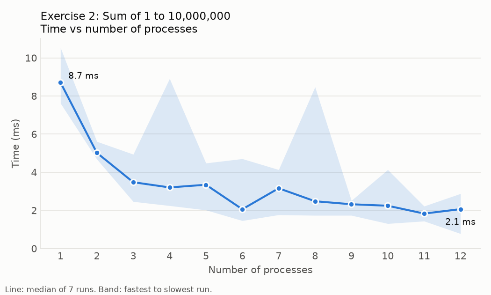
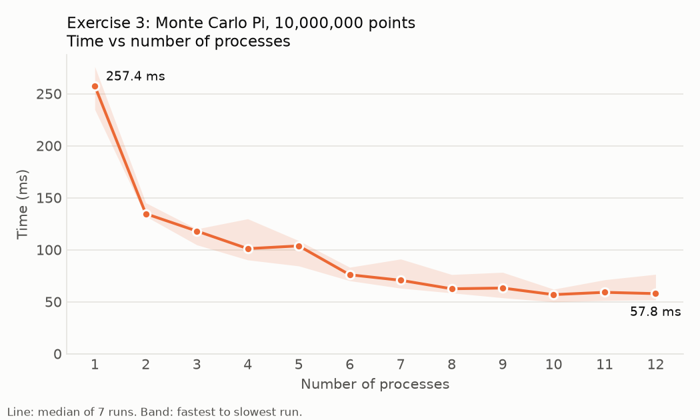
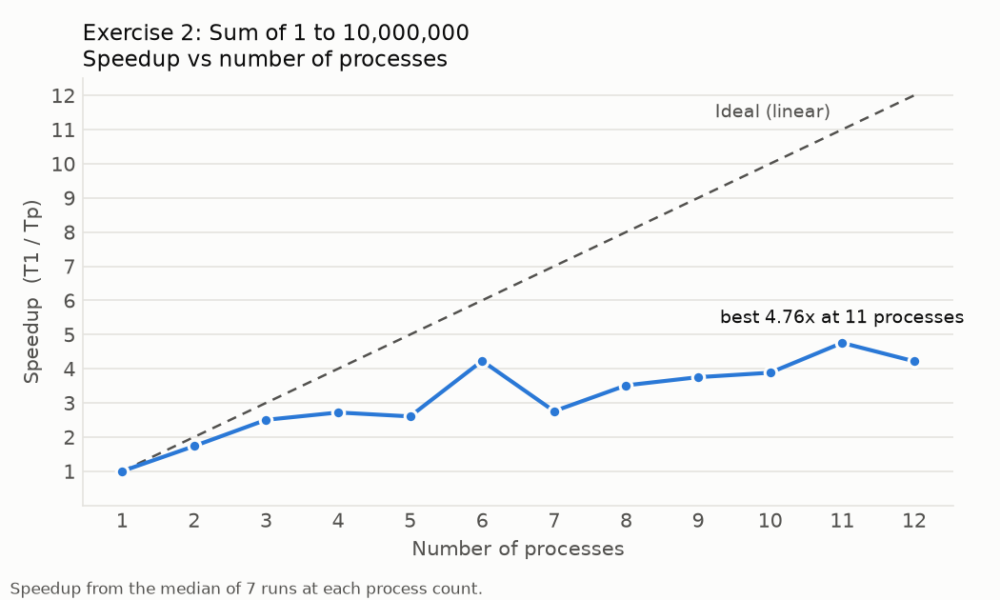
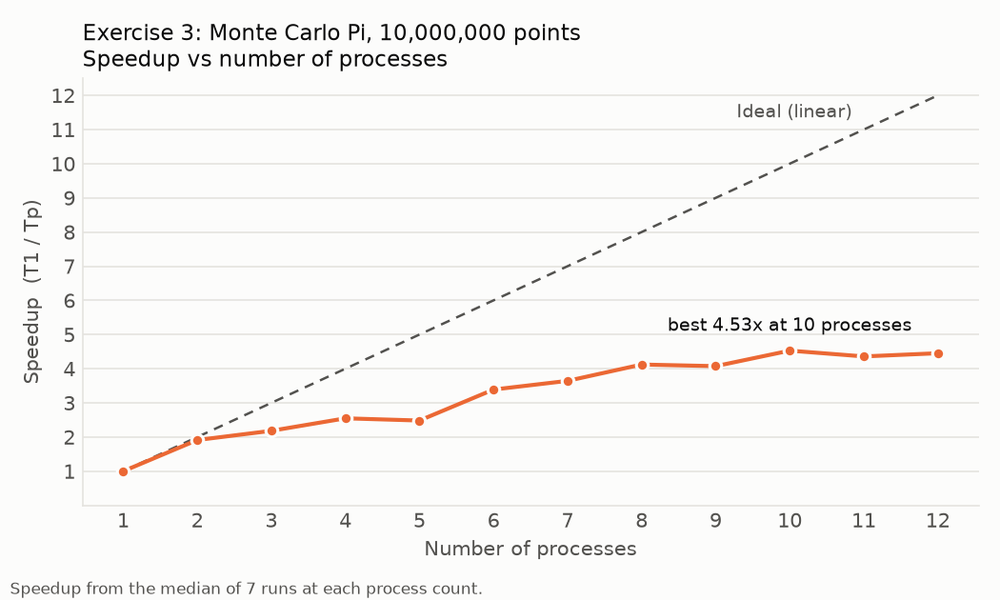

# Lab 08 – MPI

SE3082 Parallel Computing · Lab sheet "Lab Sheet 6 – MPI"

| Exercise | Topic | Files |
|---|---|---|
| [0](Exercise00/report.txt) | In-class activities from [SE4060-MPI-Part1](https://github.com/SLIIT-FacultyOfComputing/SE4060-MPI-Part1) | `HelloMPI.c`, `messages1.cc`, `messaage2.cc` |
| [1](Exercise01/report.txt) | GitHub repository for the lab | this repository |
| [2](Exercise02/report.txt) | Sum 1 to 10,000,000 with MPI | `sum_mpi.c` |
| [3](Exercise03/report.txt) | Monte Carlo Pi with MPI, 10,000,000 points | `monte_pi.c` (serial sample), `pi_mpi.c` |
| [4](Exercise04/report.txt) | Time and Speedup vs number of processes | `run_timings.sh`, `timings.csv`, 4 graphs |
| [5](Exercise05/report.txt) | Mismatched source/destination; `messaage2.cc` with `MPI_Bsend` | `messages_mismatch.cc`, `message2_bsend.cc` |
| [6](Exercise06/report.txt) | Exercise 3 receiving from `MPI_ANY_SOURCE` | `pi_any_source.c` |
| [7](Exercise07/report.txt) | Exercise 6 with `MPI_Bsend` | `pi_bsend.c`, `compare_3_6_7.sh` |

Each exercise folder has a `report.txt` and the real output of the programs (`output*.txt`).

## Build and run

```bash
make                          # compiles every program
./run_all.sh                  # runs them all, writes ExerciseXX/output*.txt
./Exercise04/run_timings.sh   # Exercise 4 timings -> Exercise04/timings.csv
python3 Exercise04/plot_timings.py   # draws the 4 graphs (needs matplotlib)
./Exercise07/compare_3_6_7.sh # fair timing comparison of Exercises 3, 6 and 7
```

Single programs follow the usual pattern, for example:

```bash
mpicc -o pi_mpi Exercise03/pi_mpi.c -lm
mpirun -np 4 ./pi_mpi
```

## Results at a glance

| | Result |
|---|---|
| Sum 1..10,000,000 | 50,000,005,000,000, correct for every process count |
| Monte Carlo Pi | 3.1412876 with 1 process (matches the serial sample program), 3.1418156 with 8 |
| Best speedup | Pi: 4.53× at 10 processes · Sum: 4.76× at 11 processes (noisy, the job only takes ~9 ms) |
| Mismatched send/receive | the program deadlocks and never finishes |
| `MPI_ANY_SOURCE` / `MPI_Bsend` | same Pi value; results arrive in a different order each run; no clear time difference |

## Environment

Run locally on a laptop: Intel Core i5-1235U (12 hardware threads), WSL Ubuntu 24.04, Open MPI 4.1.6, gcc 13.3.
`mpirun --use-hwthread-cpus` was used so that up to 12 processes could start. WSL here only has the root account, so the scripts set Open MPI's `OMPI_ALLOW_RUN_AS_ROOT` variables when they run as root.

### Exercise 4 graphs

| Exercise 2 (sum) | Exercise 3 (Pi) |
|---|---|
|  |  |
|  |  |
